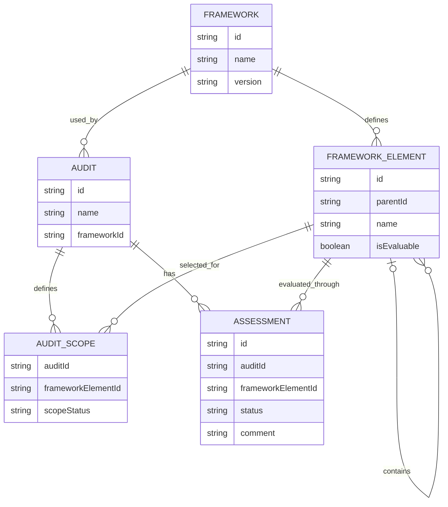

# Ratatoskr Check: Data Model

**Status:** Conceptual draft

## 1. Purpose

This document describes the conceptual data model for Ratatoskr Check. It defines the main entities, their relationships, and the rules governing audit scope, requirement assessments, and progress calculation.

The initial implementation will focus on NIST CSF 2.0, while keeping the model adaptable to other cybersecurity and compliance frameworks in the future.

## 2. Core Concepts

### 2.1 Audit

An Audit represents an individual assessment exercise.

Each audit contains its own:
- Metadata (name, organization, auditor, dates, and other relevant information).
- Selected framework.
- Audit scope.
- Assessments and associated comments.

Audits must remain independent of one another. Changes made to one audit must not affect another.

### 2.2 Framework

A Framework represents a predefined cybersecurity or compliance standard, such as NIST CSF 2.0.

Frameworks are included and maintained as part of the application. Users select an available framework when creating an audit but do not modify its original structure or requirements.

Framework definitions act as shared reference data. A single framework can be used by multiple independent audits.

### 2.3 Framework Structure and Evaluable Items

Frameworks may organize their content using different hierarchical structures and levels.

Examples include:
- NIST CSF 2.0: Functions → Categories → Subcategories.
- Other frameworks may use Domains → Controls, Sections → Requirements, or other structures.

The data model must not assume that every framework follows the same hierarchy.

Framework elements are represented through a generic hierarchical structure. Each element may contain:
- A unique identifier.
- A name and descriptive information.
- A reference to its parent element, if applicable.
- Child elements, if applicable.
- An indication of whether it is structural or evaluable.

Framework elements may serve different purposes:
- **Structural elements:** Organize framework content into groups and levels.
- **Evaluable elements:** Represent requirements or controls that can be assessed individually.

An evaluable element may also contain more specific evaluable elements, depending on the framework.

The framework's original hierarchy must be preserved rather than replaced with an application-defined structure.

The application must also distinguish between an element's eligibility for scope selection and its actual inclusion in a particular audit. These are separate concepts.

### 2.4 Assessment

An Assessment represents the evaluation of an individual evaluable framework element within a specific audit.

Each assessment belongs to one audit and one evaluable framework element.

An assessment contains:
- `id`
- `auditId`
- `frameworkElementId`
- `status`
- `comment` (optional)

The `comment` field allows the auditor to record contextual information, explanations, commitments, discussions, and other relevant observations.

For the initial implementation, each assessment has one editable comment. Comment history, multiple comments, attachments, and formal finding management are outside the current scope.

Assessment records are initialized when an audit is created. Every in-scope evaluable element receives an assessment with the initial status `Pending`.

### 2.5 Audit Scope

Audit Scope represents the relationship between a specific audit and an individual framework element.

It determines whether an evaluable element is included in or excluded from a particular audit.

Scope information contains:
- The audit identifier.
- The framework element identifier.
- Its scope state (`Included` or `Excluded`).

A framework element may be included in one audit and excluded from another without modifying the original framework definition.

## 3. Scope Management

The audit scope determines which evaluable framework elements are included in a particular audit.

Scope is independent of the assessment status.

An element can be:
- **In scope:** Included in the audit and considered in its assessments and progress calculations.
- **Out of scope:** Excluded from the audit and its progress calculations.

Only eligible framework elements can be selected for the audit scope. Eligibility and scope selection are separate rules.

Out-of-scope elements should not appear as active assessment items on the audit board.

Changing an element from in scope to out of scope should preserve its existing assessment and comments. If the element is included again, its previous information should be available.

The scope must be configurable when creating an audit and modifiable afterward.

Scope is represented independently from the Audit entity through a relationship between the audit and its framework elements.

**Important distinction:** Not Applicable is not an assessment status. Applicability is determined through scope management. An element excluded from the audit is not treated as an unfinished or failed assessment.

## 4. Relationships

### 4.1 Conceptual Entity Relationship Diagram

This diagram represents the conceptual relationships. It does not establish the final database schema or technical implementation.

### 4.2 Hierarchical Assessment and Progress

The audit board displays the main framework groups as cards.

Each card represents a structural element of the selected framework and provides an overview of the assessment status of its in-scope evaluable descendants.

The auditor can expand a group to access its underlying categories, controls, requirements, or other framework elements.

Parent elements do not necessarily require their own independent assessment. Their displayed status and progress can be derived from the assessments of their in-scope evaluable descendants.

When a child assessment changes, the corresponding parent information must be recalculated.

## 5. Assessment Status and Progress Calculation

Assessment statuses describe the situation of a requirement in relation to the audit. They do not represent the auditor's personal work progress.

The initial implementation uses three statuses:

| Status | Meaning | Visual reference |
|---|---|---|
| `Completed` | The organization has all the requested items or evidence for the requirement. | Green |
| `In Progress` | Some requested items or evidence are missing, but there is a commitment or ongoing action to provide them. | Yellow |
| `Pending` | The requested items or evidence are unavailable, with no current commitment or action to provide them. | Red |

Every newly initialized assessment starts with `Pending`.

The auditor can record additional context in the assessment comment.

For example, a missing document may be marked as `In Progress` when the responsible person commits to providing it later. The comment can record the commitment and its circumstances.

The status may change as new evidence or information becomes available.

### 5.1 Parent Status Calculation

Parent elements derive their status from their in-scope evaluable descendants.

The general rules are:

- A parent is `Completed` when all its in-scope evaluable descendants are `Completed`.
- A parent is `Pending` when all its in-scope evaluable descendants are `Pending`.
- A parent is `In Progress` when its descendants have a mixed status or at least one descendant is `In Progress`.

A parent with no in-scope evaluable descendants must not be automatically marked as `Completed`.

Instead, the application displays `No items in scope` for that group.

### 5.2 Progress Calculation

Progress represents the proportion of in-scope evaluable elements that have reached `Completed`.

Out-of-scope elements are excluded from the calculation.

For example, if an audit contains 10 in-scope evaluable elements and 4 are `Completed`, the completion percentage is 40%.

`In Progress` and `Pending` elements remain in the denominator but do not count as completed.

This calculation represents assessment coverage against the selected requirements. It should not be interpreted as an overall compliance score or as a measure of the auditor's personal productivity.

If an audit has no in-scope evaluable elements, the application displays `N/A` instead of a completion percentage.

## 6. Data Independence and Persistence

Each audit must maintain its own metadata, scope, assessments, and comments.

Framework definitions are shared reference data and must not be modified by individual audits.

The application is intended to follow a local-first approach:
- Audit information is stored locally.
- Changes are saved automatically.
- Audits remain independent.
- Users can export and import audit sessions.
- Exported sessions are intended to support backup and transfer between environments.

The final storage mechanism and technical implementation will be defined during architecture and technology decisions.

## 7. Design Decisions and Future Considerations

The following conceptual decisions have been established:

1. **Hierarchy representation:** Framework elements use a generic parent-child structure that supports different framework hierarchies.
2. **Scope representation:** Scope is maintained independently through relationships between audits and framework elements.
3. **Assessment initialization:** All in-scope evaluable elements receive an assessment when an audit is created, initially set to `Pending`.
4. **Empty scope behavior:** Audits without in-scope evaluable elements display `N/A`. Groups without in-scope evaluable descendants display `No items in scope`.

Further technical details, including hierarchy representation, scope eligibility rules, and persistence implementation, will be addressed during development.