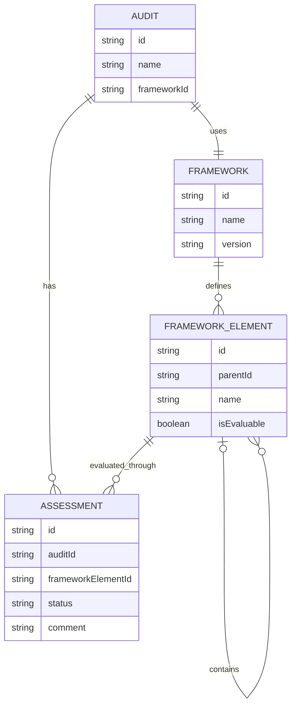

# Ratatoskr Check: Data Model

**Status:** Conceptual draft

## 1. Purpose

This document describes the conceptual data model for Ratatoskr Check. It defines the main entities, their relationships, and the rules governing audit scope, requirement assessments, and progress calculation.

The initial implementation will focus on NIST CSF 2.0, while keeping the model adaptable to other cybersecurity and compliance frameworks in the future.

## 2. Core Concepts

### 2.1 Audit

An Audit represents an individual assessment exercise.

Each audit contains its own:
- Metadata (name, organization, auditor, dates, and other relevant information).
- Selected framework.
- Audit scope.
- Assessments and associated notes.

Audits must remain independent of one another. Changes made to one audit must not affect another.

### 2.2 Framework

A Framework represents a predefined cybersecurity or compliance standard, such as NIST CSF 2.0.

Frameworks are included and maintained as part of the application. Users select an available framework when creating an audit but do not modify its original structure or requirements.

Framework definitions act as shared reference data.

### 2.3 Framework Structure and Evaluable Items

Frameworks may organize their content using different hierarchical structures and levels.

Examples include:
- NIST CSF 2.0: Functions → Categories → Subcategories.
- Other frameworks may use Domains → Controls, Sections → Requirements, or other structures.

The data model must not assume that every framework follows the same hierarchy.

Framework elements may serve different purposes:
- **Structural elements:** Organize framework content into groups and levels.
- **Evaluable elements:** Represent requirements or controls that can be assessed individually.

An evaluable element may also contain more specific evaluable elements, depending on the framework.

The framework's original hierarchy must be preserved rather than replaced with an application-defined structure.

### 2.4 Assessment

An Assessment represents the evaluation of an individual evaluable framework element within a specific audit.

Each assessment belongs to one audit and one evaluable framework element.

An assessment contains:
- `id`
- `auditId`
- `frameworkElementId`
- `status`
- `comment` (optional)

The `comment` field allows the auditor to record contextual information, explanations, commitments, discussions, and other relevant observations.

For the initial implementation, each assessment has one editable comment. Comment history, multiple comments, attachments, and formal finding management are outside the current scope.

## 3. Scope Management

The audit scope determines which evaluable framework elements are included in a particular audit.

Scope is independent of the assessment status.

An element can be:
- **In scope:** Included in the audit and considered in its assessments and progress calculations.
- **Out of scope:** Excluded from the audit and its progress calculations.

Out-of-scope elements should not appear as active assessment items on the audit board.

Changing an element from in scope to out of scope should preserve its existing assessment and comments. If the element is included again, its previous information should be available.

The scope must be configurable when creating an audit and modifiable afterward.

The technical representation of scope remains an open design question. It may be represented as part of the audit or through a separate structure.

**Important distinction:** Not Applicable is not an assessment status. Applicability is determined through scope management. An element excluded from the audit is not treated as an unfinished or failed assessment.

## 4. Relationships

### 4.1 Conceptual Entity Relationship Diagram

This diagram represents the conceptual relationships. It does not establish the final database schema or the technical implementation of scope.

### 4.2 Hierarchical Assessment and Progress

The audit board displays the main framework groups as cards.

Each card represents a structural element of the selected framework and provides an overview of the assessment status of its evaluable descendants.

The auditor can expand a group to access its underlying categories, controls, requirements, or other framework elements.

Parent elements do not necessarily require their own independent assessment. Their displayed status and progress can be derived from the assessments of their in-scope evaluable descendants.

When a child assessment changes, the corresponding parent information must be recalculated.

## 5. Assessment Status and Progress Calculation

Assessment statuses describe the situation of a requirement in relation to the audit. They do not represent the auditor's personal work progress.

The initial implementation uses three statuses:

| Status | Meaning | Visual reference |
|---|---|---|
| `Completed` | The organization has all the requested items or evidence for the requirement. | Green |
| `In Progress` | Some requested items or evidence are missing, but there is a commitment or ongoing action to provide them. | Yellow |
| `Pending` | The requested items or evidence are unavailable, with no current commitment or action to provide them. | Red |

The auditor can record additional context in the assessment comment.

For example, a missing document may be marked as `In Progress` when the responsible person commits to providing it later. The comment can record the commitment and its circumstances.

The status may change as new evidence or information becomes available.

### 5.1 Parent Status Calculation

Parent elements derive their status from their in-scope evaluable descendants.

The general rules are:

- A parent is `Completed` when all its in-scope evaluable descendants are `Completed`.
- A parent is `Pending` when all its in-scope evaluable descendants are `Pending`.
- A parent is `In Progress` when its descendants have a mixed status or at least one descendant is `In Progress`.

A parent with no in-scope evaluable descendants must be handled as a separate empty-scope case rather than automatically marked as `Completed`.

### 5.2 Progress Calculation

Progress represents the proportion of in-scope evaluable elements that have reached `Completed`.

Out-of-scope elements are excluded from the calculation.

For example, if an audit contains 10 in-scope evaluable elements and 4 are `Completed`, the completion percentage is 40%.

`In Progress` and `Pending` elements remain in the denominator but do not count as completed.

This calculation represents assessment coverage against the selected requirements. It should not be interpreted as an overall compliance score or as a measure of the auditor's personal productivity.

If an audit has no in-scope evaluable elements, the application should display a separate state rather than calculating a percentage from an empty set.

## 6. Data Independence and Persistence

Each audit must maintain its own metadata, scope, assessments, and comments.

Framework definitions are shared reference data and must not be modified by individual audits.

The application is intended to follow a local-first approach:
- Audit information is stored locally.
- Changes are saved automatically.
- Audits remain independent.
- Users can export and import audit sessions.
- Exported sessions are intended to support backup and transfer between environments.

The final storage mechanism and technical implementation will be defined during architecture and technology decisions.

## 7. Open Design Questions

The following decisions remain open:

1. **Hierarchy representation:** How should variable framework structures be represented technically?
2. **Scope representation:** Should scope be stored as part of the Audit entity or through a separate structure?
3. **Assessment initialization:** Should assessment records be created for every in-scope evaluable element when an audit is created, or created when an element is first assessed?
4. **Empty scope behavior:** How should the interface display framework groups or audits that contain no in-scope evaluable elements?

These questions will be resolved as the architecture and implementation are developed.